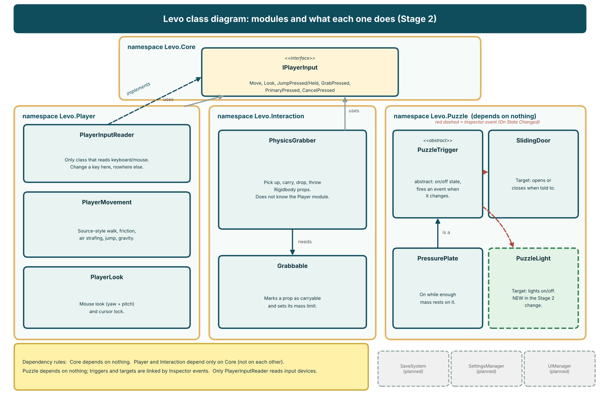

# Levo architecture (Stage 2: modular)

## Modules and their one job
| Module (folder / namespace) | Class | Responsibility |
|---|---|---|
| `Core` | `IPlayerInput` | Describes the input the game needs (move, look, jump, grab, primary, cancel). No logic. |
| `Player` | `PlayerInputReader` | The only class that reads keyboard/mouse. Implements `IPlayerInput`. |
| `Player` | `PlayerMovement` | Source-style walking, friction, air strafing, jump, gravity. |
| `Player` | `PlayerLook` | Mouse look and cursor lock. |
| `Interaction` | `PhysicsGrabber` | Pick up, carry, drop and throw physics props. |
| `Interaction` | `Grabbable` | Marks a prop as carryable and sets its mass limit. |
| `Puzzle` | `PuzzleTrigger` (abstract) | Holds on/off state and fires an event when it changes. |
| `Puzzle` | `PressurePlate` | A trigger that is on while enough mass rests on it. |
| `Puzzle` | `SlidingDoor` | A target that opens/closes when told to. |
| `Puzzle` | `PuzzleLight` | A target that switches a light (added later as the Stage 2 change). |

## Dependency rules
1. `Core` depends on nothing.
2. `Player` and `Interaction` depend only on `Core` (never on each other).
3. `Puzzle` depends on nothing in the game. Triggers and targets are connected by Inspector events, not by code references.
4. Only `PlayerInputReader` may use `UnityEngine.InputSystem` devices.

## Change made without rewriting unrelated systems
**Change:** added a new puzzle target, `PuzzleLight`, wired to the existing `PressurePlate`.
**Files changed:** 1 new file (`Assets/Levo/Scripts/Puzzle/PuzzleLight.cs`). 0 existing scripts edited.
**Evidence:** the git commit for this change shows only that file (plus its `.meta` and the scene wiring).

## What this makes possible next
- Stage 3 (tests): a fake `IPlayerInput` lets movement and grabbing be tested without a keyboard.
- Stage 5 (settings): keybinds and sensitivity change in `PlayerInputReader` / `PlayerLook` only.
- Stage 6 (access): alternative controls are another `IPlayerInput` implementation.
